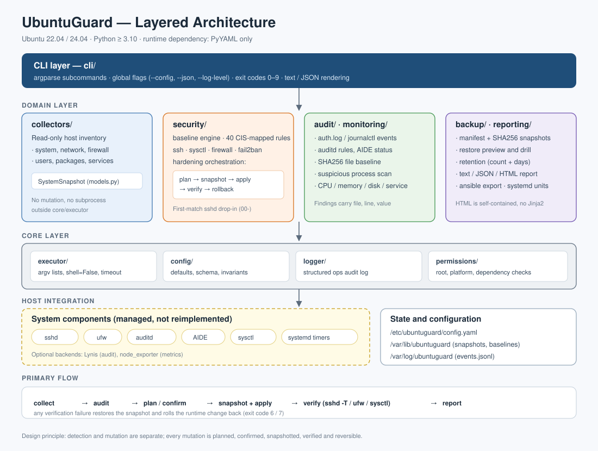

# UbuntuGuard

[](https://github.com/ziki39223-dev/UbuntuGuard/actions/workflows/ci.yml)
[](https://github.com/ziki39223-dev/UbuntuGuard/releases/latest)
[](LICENSE)

**Security operations for Ubuntu hosts in one CLI**: collect → audit against a 40-rule CIS-mapped baseline → plan and apply reversible hardening → detect login and integrity anomalies → monitor health → verify backups → render a self-contained report.

Targets Ubuntu 22.04 and 24.04. Python ≥ 3.10, single runtime dependency (`PyYAML`), no agent, no daemon, no database.

## Why another security tool

UbuntuGuard does not reimplement auditing engines, monitoring stacks or IDS. It orchestrates the tools a Linux administrator already trusts — OpenSSH, UFW, Fail2ban, auditd, AIDE, sysctl — and adds what those tools lack: a single workflow, explicit change plans, pre-change snapshots, post-change verification and automatic rollback. Lynis can be used as an optional audit backend.

Design principles:

- **Detection and mutation are separate.** Audits are read-only; changes require a plan, a diff and an explicit confirmation.
- **Snapshot before change, verify after change.** Every mutation is verified on the live system (`sshd -T`, `ufw status`, `sysctl -n`); failures restore files and roll back runtime changes.
- **Evidence in every finding.** File path, line number, raw value or command output.
- **Capability detection over version checks.** `os-release`, `command -v`, `sshd -T` instead of hard-coded assumptions.
- **Minimal dependency surface.** PyYAML plus the standard library; HTML reports are rendered without a template engine.

## Architecture



`cli → domain layer → core`. The domain layer holds read-only collectors, the baseline rule engine and hardening actions, audit/monitoring, backups and reporting. The core layer provides the single command executor (argv lists, `shell=False`, timeouts, structured results), configuration validation, structured logging and permission checks. Host state lives in `/etc/ubuntuguard`, `/var/lib/ubuntuguard` and `/var/log/ubuntuguard`.

See [ARCHITECTURE.md](ARCHITECTURE.md) for abstractions and safety boundaries.

## Installation

```bash
# 1. Signed APT repository (Ubuntu 24.04 / noble)
sudo curl -fsSL https://ziki39223-dev.github.io/UbuntuGuard/ubuntuguard-archive-keyring.gpg \
  -o /usr/share/keyrings/ubuntuguard-archive-keyring.gpg
echo "deb [signed-by=/usr/share/keyrings/ubuntuguard-archive-keyring.gpg] https://ziki39223-dev.github.io/UbuntuGuard noble main" \
  | sudo tee /etc/apt/sources.list.d/ubuntuguard.list
sudo apt update && sudo apt install ubuntuguard

# 2. Source or virtualenv (22.04 and 24.04)
python3 -m venv /opt/ug && /opt/ug/bin/pip install "git+https://github.com/ziki39223-dev/UbuntuGuard.git@v1.0.2"

# 3. Offline deb from the release page (Ubuntu 24.04)
sudo apt install ./ubuntuguard_1.0.2-1_all.deb
```

The APT repository metadata is GPG-signed (`InRelease`). Build, publish and key rotation are documented in [docs/PACKAGE_SIGNING.md](docs/PACKAGE_SIGNING.md).

## Quick start

```bash
ubuntuguard doctor                        # platform, permissions, dependencies
ubuntuguard collect                       # host inventory
ubuntuguard audit                         # 40-rule baseline, text output
ubuntuguard --json audit                  # machine-readable audit report
ubuntuguard audit --engine all            # own rules + Lynis backend
ubuntuguard harden plan                   # read-only plan and diff
ubuntuguard --yes harden apply --apply    # root, snapshot, verify, rollback on failure
ubuntuguard detect                        # logins, auditd/AIDE, file hashes, processes
ubuntuguard monitor check --no-notify     # CPU, memory, disk, load, services
ubuntuguard backup create                 # snapshot of managed configuration
ubuntuguard backup verify <id>            # SHA256 verification
ubuntuguard backup drill <id>             # restore into a temp directory
ubuntuguard backup restore <id> --force   # preview diff, then restore
ubuntuguard report --format html --out report.html
ubuntuguard export ansible --out harden.yml
ubuntuguard systemd install               # audit + monitor timers
```

Global flags (`--config`, `--json`, `--log-level`) go before the subcommand.

## Configuration

Default path: `/etc/ubuntuguard/config.yaml`, overridable with `--config` or `UBUNTUGUARD_CONFIG`. Built-in defaults are used when the file is absent. Example: [configs/config.example.yaml](configs/config.example.yaml).

Two invariants are enforced at startup: `harden.require_confirmation` and `harden.backup_before_change` must both be `true`.

## Hardening safety model

1. `harden plan` produces a `ChangePlan` per action and prints the diff; nothing is written.
2. `harden apply --apply --yes` (root only) creates a snapshot with manifest and SHA256, then applies drop-in files and runtime changes.
3. Each action verifies the effective state on the live system.
4. Any failure restores the snapshot files and rolls back runtime changes.

Relevant exit codes:

| Code | Meaning |
| ---- | ------- |
| 0 | success |
| 2 | usage error |
| 3 | permission denied |
| 4 | audit findings at or above `--fail-on` |
| 6 | change rolled back |
| 7 | rollback failed |
| 9 | unsupported platform or no executable checks |

Packages installed by apt during hardening are not removed on rollback (see `DECISIONS.md` D-014).

## Verification

- **Unit and static checks**: 165 tests, ruff and mypy on Python 3.10 and 3.12 (GitHub Actions matrix).
- **Packaging**: deb built on 24.04; installation, upgrade and purge verified; the signed APT repository is exercised in CI by installing from it.
- **Real systemd integration**: `scripts/integration-test.sh` enables ufw, auditd, AIDE and sshd, then runs 34 assertions (audit → backup → harden → verify → detect → monitor → systemd units → restore → report). It runs on GitHub-hosted runners and on cloud hosts.
- **Public cloud validation**: Alibaba Cloud ECS with Ubuntu 22.04.5 and 24.04.5. Both runs passed 34/34 assertions; after hardening, findings dropped from 16 to 10 and only port 22 remained reachable from the Internet.

## Documentation

| Document | Contents |
| -------- | -------- |
| [ARCHITECTURE.md](ARCHITECTURE.md) | Layers, abstractions, safety boundaries |
| [docs/TECHNICAL_DESIGN.md](docs/TECHNICAL_DESIGN.md) | CLI, config schema, report formats, compatibility |
| [docs/ECOSYSTEM_AND_POSITIONING.md](docs/ECOSYSTEM_AND_POSITIONING.md) | Ecosystem research and differentiation |
| [docs/CIS_MAPPING.md](docs/CIS_MAPPING.md) | Rule-to-CIS control mapping (24.04 and 22.04) |
| [docs/PACKAGE_SIGNING.md](docs/PACKAGE_SIGNING.md) | GPG key, APT repository build and release |
| [docs/PPA.md](docs/PPA.md) | Signed source package for Launchpad PPA |
| [TEST_REPORT.md](TEST_REPORT.md) | Test and validation report |
| [PROJECT_STATUS.md](PROJECT_STATUS.md) | Current status |
| [ROADMAP.md](ROADMAP.md) | Phase plan |
| [DECISIONS.md](DECISIONS.md) | Architecture decision records |
| [RISK_REGISTER.md](RISK_REGISTER.md) | Risks and mitigations |

## License

MIT. See [LICENSE](LICENSE).

中文说明见 [README.md](README.md)。
